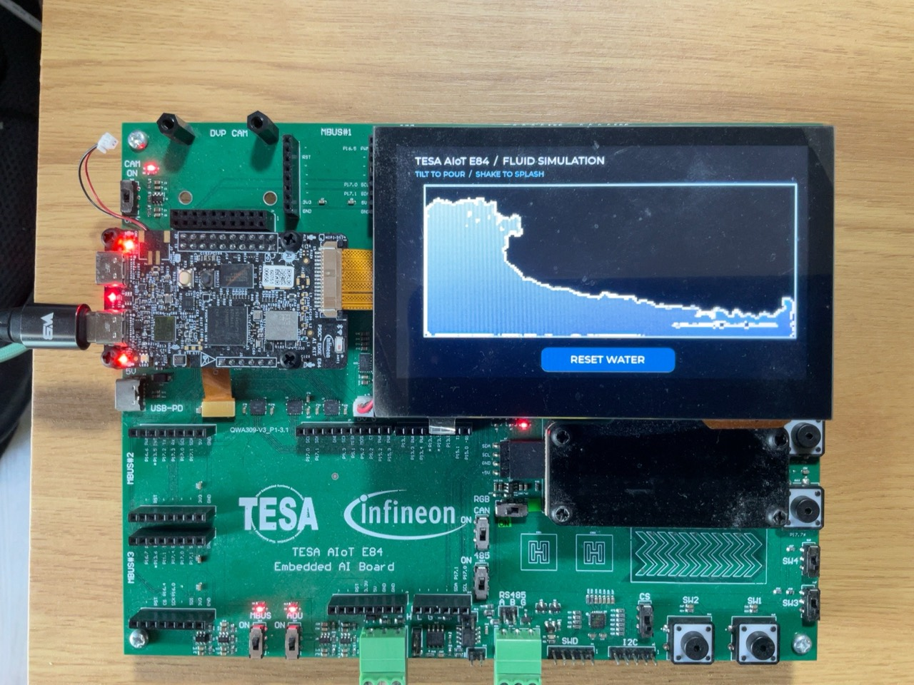

# Chapter 019 — BMI270 particle fluid

[All examples](../README.md) · [Host setup](../docs/SETUP.md) · [Test scope](../docs/TESTING.md) · [Flash safety](../docs/STORAGE.md)

Unless a command explicitly says repository root, run it from this chapter
directory using the environment in the setup guide. Programming replaces the
current board firmware; check the storage guide before running write tests.

An interactive 2-D liquid simulation for the 800×480 Waveshare DSI display.
480 particles have velocity, gravity, density pressure, cohesion, and wall
collisions. The liquid pools against the low edge, sloshes after movement,
and can separate into droplets. This is a lightweight visual approximation
using double-density relaxation, not an engineering fluid solver.



*Physical hardware result supplied by the user. The user confirmed the
corrected tilt direction on 2026-10-09.*

The exact particle state is rasterized into a 180×78 RGB565 density image,
displayed at 4× scale in LVGL. The filled shape follows the particles: there
is no fixed rectangular fill or independently animated waterline.
The application expands the raster to 720×312 in graphics SRAM before LVGL
draws it, avoiding expensive per-pixel image transformations during refresh.
It reuses the verified GFXSS/DSI clock startup from Chapter 017 and FT5406
touch input from Chapter 018.

Tilt or rotate the board to pour the water; move it briskly to create slosh.
Touch `RESET WATER` to restore the starting pool. BMI270 X/Y acceleration
drives screen-plane gravity. For the TESA landscape mounting, screen gravity
is `(+accel_x, -accel_y)`. The first version used the opposite signs and the
user's physical photos showed water collecting at the raised edges.
The corrected mapping reverses both signs. Z is not added to screen gravity:
that former strong downward bias also prevented pouring toward the top.
A weak downward preference remains only within 80 mg of flat and fades
to zero at that threshold (approximately 5 degrees). The live mode is
labelled `TILT TO POUR / SHAKE TO SPLASH`.

## Build, flash, and verify

```bash
./build.sh
./flash.sh
python3 test_firmware.py
python3 test_fluid.py
```

The serial test checks fresh responses, advancing animation/IMU/touch counters,
particle bounds, nonempty raster, reset, and movement of the fluid's centre
under injected left/right/up/down gravity. It restores live IMU control in
a `finally` block. Test gravity is labelled on-screen and expires after
15 seconds even if the host disconnects. These injected tests verify the
simulation on hardware; they do not prove physical tilt orientation or visible
LCD output. `--wait-for-tilt` separately waits for physical accelerometer motion.

Run independent cases with `python3 test_firmware.py --case health`,
`--case reset`, `--case left`, `--case right`, `--case up`, or `--case down`.
Use `--case response` to time how long the liquid takes to cross the left-side
threshold from a reset pool under a fixed test force; it restores live control.
Console commands are `water info|reset|auto|left|right|up|down TOKEN`;
`water level TOKEN` is a compatibility alias for reset.

`test_fluid.py` compiles the same C engine with the host C compiler and checks
pooling in four directions, particle bounds through 1,200 shake frames,
changing rendered pixels, and deterministic reset. It also compiles the same
`motion.c` as the firmware and checks synthetic sensor poses for all four
raised edges, gentle tilt toward the top, and the flat-desk fallback. Those
poses document the corrected mounting convention; physical direction was
separately confirmed by the user. If Pillow is installed,
it also saves an image of the actual raster under `test-results/`.

The engine advances at 60 physics steps per elapsed second independently of
display refresh. Each step remains 1/60 second for stability, with at most six
catch-up steps per frame after a long pause. The target display interval is
33 ms. Status reports measured `step_us` (physics, raster, CRC) and `frame_ms`
(including refresh scheduling).

The faster-response revision raises tilt gain from 0.18 to 0.27 (50%), raises
the per-sample gravity filter weight from 0.30 to 0.65, and increases the
velocity limit from 160 to 220 pixels/second. Compiler speed optimization is
enabled. This fixes the original half-speed physics at approximately 15 FPS
without changing the confirmed axis directions or the flat-desk fallback.
Host tests verify identical motion over two elapsed seconds at 60/30/20/15
display FPS, bounded catch-up after pauses, and stability at the higher forces.

## Hardware verification (2026-10-09)

Built and programmed CM55 plus the Chapter 017 CM33 startup image. The serial
suite passed health, reset, all four injected gravity directions, and return
to IMU mode. Observed animation intervals were typically 50–67 ms (15–20 fps),
with physics/raster/CRC taking approximately 16–22 ms. UART status requests
occasionally lengthen a frame. This is below the 30 fps target.

Host tests also passed four-way pooling, reset, and the 1,200-frame shake test.
After correcting the reversed directions, the user confirmed that the liquid
flows toward the lower edge and supplied the hardware photo above. This
physical confirmation complements the automated tests; serial checks alone
cannot certify what is visible on the panel.

### Faster response verification

Programmed and tested the elapsed-time physics revision on the same board.
With the same reset pool, injected force, and serial polling, `--case response`
reached the left-side threshold in **0.660 s**, compared with **1.664 s** before
the change (approximately 2.5× faster). This measures controlled fluid movement,
not a physical hand-to-screen latency measurement. Health, reset, all four
gravity directions, and restoring IMU control passed after programming.
Host timing and stronger-force stability tests passed as well.
